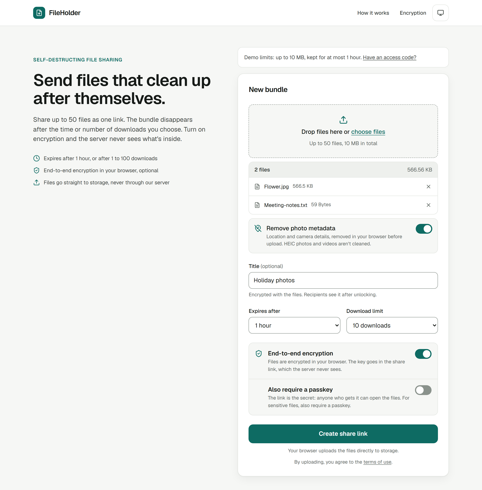
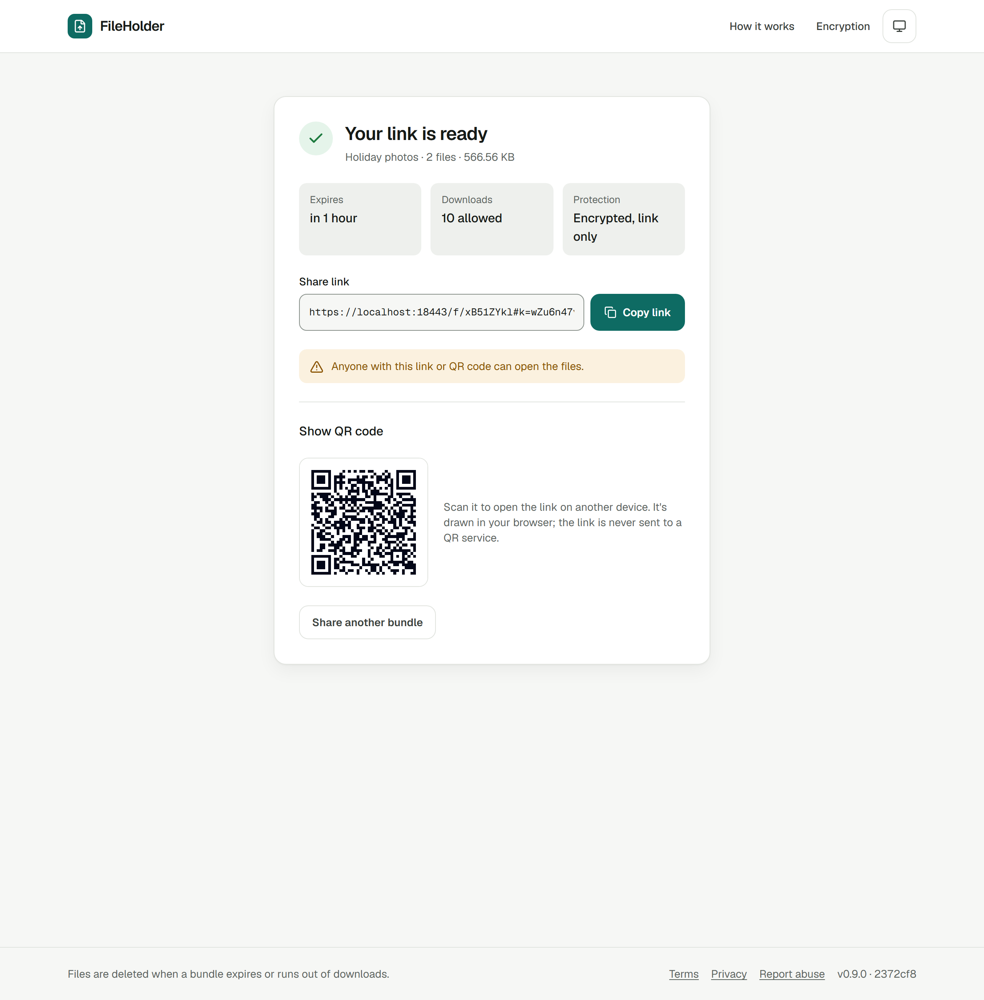
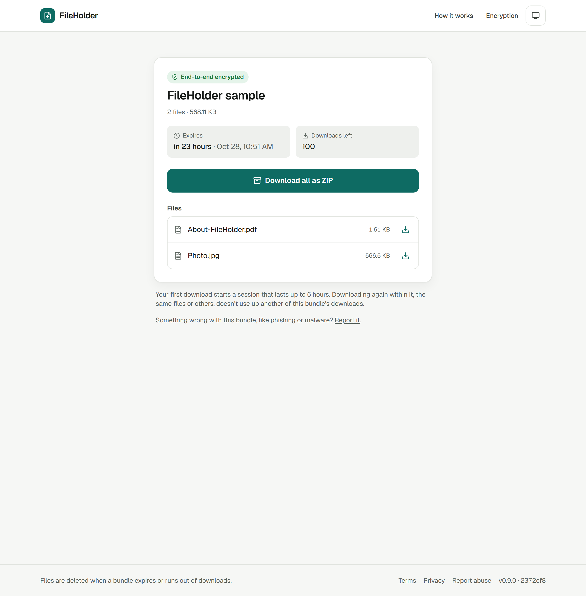
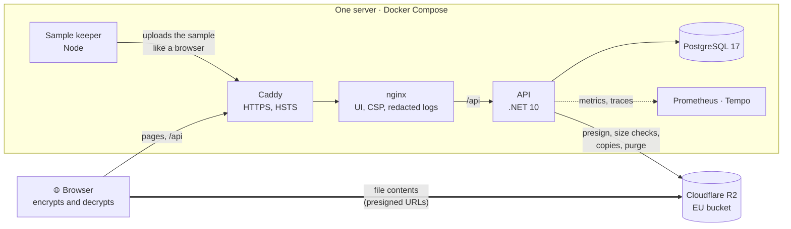

# 📁 FileHolder

> **Share files that delete themselves.** Optionally end-to-end encrypted in your browser: the server never sees the files, their names or the key.

[](CHANGELOG.md)
[](LICENSE)


**[🌐 Try it at fileholder.app](https://fileholder.app)** · **[📦 Open a sample bundle](https://fileholder.app/sample)**: one click, nothing to upload, decrypted in your browser.

<picture>
  <source media="(prefers-color-scheme: dark)" srcset="docs/images/upload-dark.png">
  
</picture>

## ✨ What It Does

* **One link for up to 50 files.** The bundle deletes itself after the time or the number of downloads you choose, and its details go with it.
* **End-to-end encryption, optional.** Files, file names and the title are encrypted in the browser. The key travels in the link's `#fragment`, which browsers never send to a server. For sensitive files, a passkey can be required as well, sent separately.
* **Photo metadata removed before upload.** Location, camera and date details come out in the browser, without re-encoding the image.
* **A QR code** for opening the link on another device, drawn in the browser.
* **On the demo:** bundles up to 10 MB that live up to an hour. An access code unlocks 250 MB and 24 hours.

| Sharing | Receiving |
| :---: | :---: |
| <picture><source media="(prefers-color-scheme: dark)" srcset="docs/images/share-link-dark.png"></picture> | <picture><source media="(prefers-color-scheme: dark)" srcset="docs/images/download-dark.png"></picture> |

## 🔍 Under the Hood

* **File contents never pass through the API.** Browsers upload and download straight to and from storage with short-lived presigned URLs: large files as parallel multipart uploads with retries. The API checks each stored file's size against what it approved before a bundle goes live. → [How It Works](docs/how-it-works.md)
* **Encryption built on WebCrypto:** AES-256-GCM in 4 MiB chunks, authenticated so they can't be reordered, dropped or added. Keys come from HKDF, and a passkey is stretched with Argon2id in a worker. The server checks a derived value on unlock, never the key. → [How It Works](docs/how-it-works.md), [threat model](docs/threat-model.md)
* **Streaming decryption, even on an iPhone.** Downloads decrypt as they arrive and go straight to disk through a service worker, a "Save as" dialog or Safari's private storage (OPFS). A 1.5 GB encrypted file was checked on a real iPhone. → [Encrypted Downloads](docs/how-it-works.md#-encrypted-downloads)
* **Deletion you can rely on:** download limits are enforced with one conditional database update, however many recipients race. A background purge removes files and details. Storage's own lifecycle rule is a safety net in case the purge ever fails. → [How It Works](docs/how-it-works.md)
* **Tested from several sides:**
  * unit and integration tests (Testcontainers);
  * property tests in C# and TypeScript, with the server's and browser's file-name rules checked against shared examples;
  * Playwright in Chromium, Firefox and WebKit;
  * network-fault tests that cut connections mid-upload;
  * k6 load tests for the rules that only matter under concurrency.

  → [Testing](docs/testing.md)
* **Run like a real service:**
  * health checks, metrics and OpenTelemetry traces, with tokens and file names redacted;
  * maintenance modes, takedowns and access codes, switched at runtime;
  * release-please releases and one-command deploys with automatic rollback;
  * hardened containers, pinned dependencies and image scanning;
  * a written [threat model](docs/threat-model.md).

  → [Running FileHolder](docs/operations.md), [Security](docs/security.md)

## 🏗️ Architecture



Locally, storage is Silo (a MinIO fork) instead of R2: the same code runs against both, and a conformance suite checks each. Grafana runs on the owner's computer and reaches Prometheus and Tempo over an SSH tunnel.

## 🛠️ Technology Stack

| Tier | Technology | Notes |
| :--- | :--- | :--- |
| **Backend API** | **.NET 10**, ASP.NET Core Minimal APIs | Route groups, typed results, FluentValidation, RFC 7807 `ProblemDetails` |
| **API docs** | Native OpenAPI + **Scalar UI** | Development only |
| **Database** | **PostgreSQL 17**, **EF Core 10** (Npgsql) | Migrations applied at startup, filtered indexes |
| **Object storage** | **Cloudflare R2** in production, **Silo** (`pgsty/silo`) locally | Accessed with the AWS SDK for .NET. Silo is a community-maintained fork of the MinIO server (MinIO wound down its community edition); the compose service is still called `minio` |
| **Caching** | .NET `HybridCache` | In-memory only (no shared L2 cache), with stampede protection |
| **Background work** | `BackgroundService` | Storage purge every 30 minutes |
| **Frontend** | **React 19**, Vite 8, TypeScript 6, Tailwind CSS 4 | axios, react-hook-form, client-zip (ZIPs in the browser), qrcode.react |
| **Observability** | OpenTelemetry metrics → Prometheus → Grafana; OpenTelemetry traces → Grafana Tempo → Grafana; Serilog console logs with trace ids | |
| **Tests** | xUnit, FluentAssertions, NSubstitute, FsCheck, Testcontainers (PostgreSQL); Vitest + Testing Library, fast-check; Playwright (Chromium, Firefox, WebKit); k6 | |
| **Hosting** | Docker Compose behind Caddy, on one VPS | Multi-stage builds, hardened containers |

## ⚡ Quick Start

Make sure [Docker Desktop](https://www.docker.com/products/docker-desktop/) is running. Then create a `.env` file next to `docker-compose.yml` with the stack's passwords, and start it. Compose refuses to start while any password is missing, and git ignores the file. `.env.example` lists what goes in it.

PowerShell:
```powershell
function New-Secret { $b = New-Object byte[] 16; [Security.Cryptography.RandomNumberGenerator]::Create().GetBytes($b); ($b | ForEach-Object { $_.ToString('x2') }) -join '' }
@(
  "GRAFANA_ADMIN_PASSWORD=$(New-Secret)"
  "POSTGRES_PASSWORD=$(New-Secret)"
  "STORAGE_ROOT_USER=fileholder-admin"
  "STORAGE_ROOT_PASSWORD=$(New-Secret)"
  "STORAGE_API_SECRET_KEY=$(New-Secret)"
  "ADMIN_TOKEN=$(New-Secret)$(New-Secret)"
) | Set-Content -Encoding ascii .env
docker compose up --build
```

Bash:
```bash
cat > .env <<EOF
GRAFANA_ADMIN_PASSWORD=$(openssl rand -hex 16)
POSTGRES_PASSWORD=$(openssl rand -hex 16)
STORAGE_ROOT_USER=fileholder-admin
STORAGE_ROOT_PASSWORD=$(openssl rand -hex 16)
STORAGE_API_SECRET_KEY=$(openssl rand -hex 16)
ADMIN_TOKEN=$(openssl rand -hex 32)
EOF
docker compose up --build
```

Then open [http://localhost:3000](http://localhost:3000). Grafana, the storage console and the health endpoints are listed in [Development](docs/development.md#application-endpoints).

## 📚 Documentation

| Page | What's in it |
| :--- | :--- |
| [How It Works](docs/how-it-works.md) | Uploading, downloading, self-destruction, the storage safety net, end-to-end encryption, photo metadata, limits |
| [Security](docs/security.md) | Storage access, file names, passwords, rate limits, headers, what logs and traces leave out, dependency checks |
| [Threat Model](docs/threat-model.md) | What each party can see and do, the protections with their code, known gaps and accepted risks |
| [Running FileHolder](docs/operations.md) | Production setup, deploying, Cloudflare R2, maintenance modes, takedown, access codes, the sample bundle, tracing, releases |
| [Development](docs/development.md) | Local endpoints, passwords, networking, every setting, the project's layout, running the API and UI outside Docker |
| [Testing](docs/testing.md) | Unit, property, browser, network-fault and load tests, the pre-deploy check, testing on a phone |
| [Changelog](CHANGELOG.md) | What each release changed |

**Found a vulnerability?** Please don't open a public issue; see [`SECURITY.md`](SECURITY.md).

## 📄 Licence

FileHolder is released under the [MIT License](LICENSE). The libraries it uses keep their own licences (mostly MIT, Apache-2.0 and BSD). Local development runs Silo, licensed under AGPL-3.0, as a separate, unmodified service, so its licence doesn't extend to FileHolder's code.
